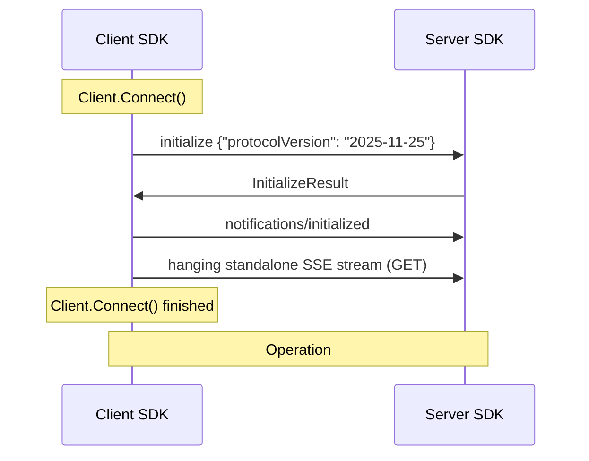
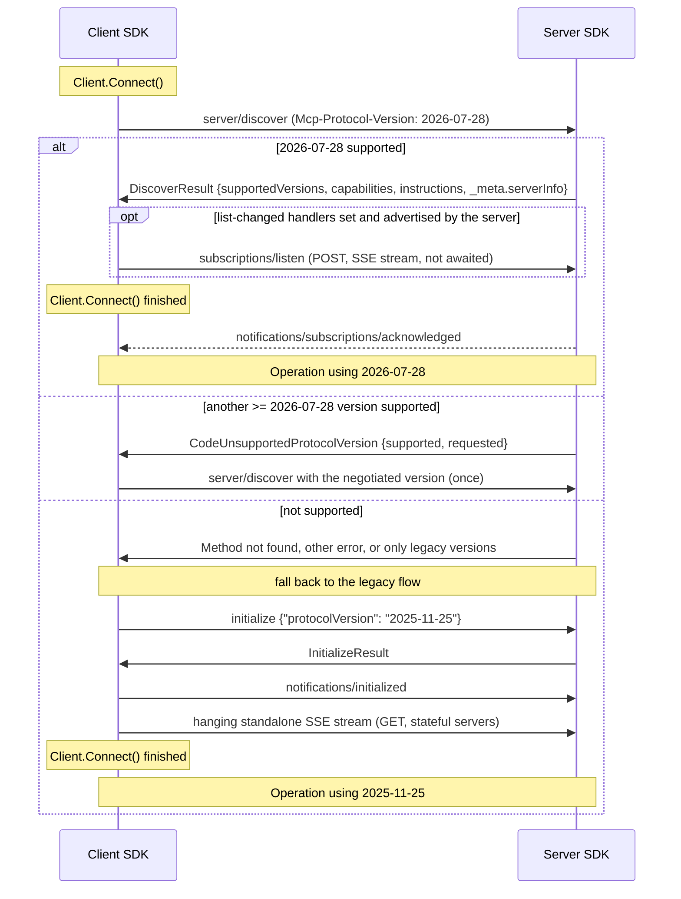
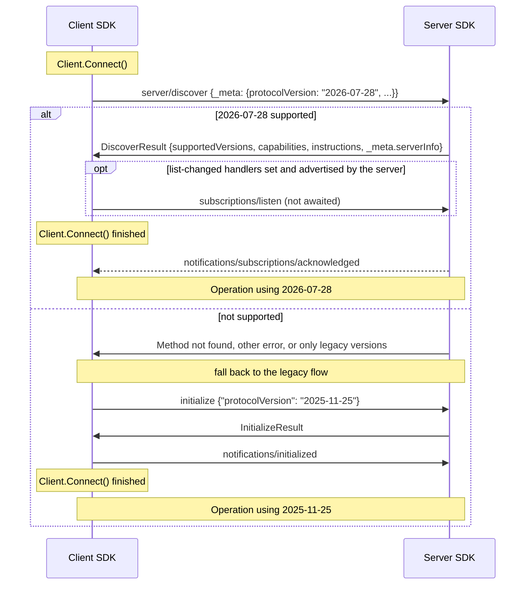

# Stateless MCP for the 2026-07-28 protocol version

This document describes how the SDK supports the stateless and sessionless
protocol introduced in protocol version `2026-07-28`. It was first written as a
proposal against the draft version `2026-06-30`, and has since been updated to
match the implementation. [Changes from the original
proposal](#changes-from-the-original-proposal) lists where the two differ.

It focuses on the following SEPs:

* [SEP-2567: Sessionless MCP via Explicit State Handles](https://github.com/modelcontextprotocol/modelcontextprotocol/pull/2567)
* [SEP-2575: Make MCP Stateless](https://github.com/modelcontextprotocol/modelcontextprotocol/pull/2575)

Related changes are covered elsewhere:

* Multi round-trip requests ([SEP-2322](https://github.com/CaitieM20/modelcontextprotocol/blob/de6d76fba3078eda957dadb3cec51ca8ab851b5c/seps/2322-MRTR.md)),
  which replace server-to-client requests, are described in [mrtr.md](mrtr.md).
* The standard HTTP headers of [SEP-2243](https://github.com/modelcontextprotocol/modelcontextprotocol/pull/2243)
  and the user-facing behavior are documented in [docs/protocol.md](../docs/protocol.md).
* The deprecation of roots, sampling and logging is defined by
  [SEP-2577](https://modelcontextprotocol.io/seps/2577-deprecate-roots-sampling-and-logging).

These proposals together define a protocol that is largely incompatible with
its previous versions. This poses challenges given our commitment to not
introduce backwards incompatible API changes to the SDK.

## Design decisions

### Stateless mode reuse

On the HTTP server side, `StreamableHTTPOptions.Stateless` already worked
similarly to what the proposals define. It is a prerequisite for the new
protocol version over HTTP: only handlers with `Stateless` set serve
`>= 2026-07-28` requests. This is expressed through the
[`ProtocolVersionSupporter`](#server-capabilities-serverdiscover) interface:

* `StreamableServerTransport` supports `>= 2026-07-28` only when `Stateless` is
  true.
* `SSEServerTransport` supports only versions below `2026-07-28`, since
  `2026-07-28` defines only the stdio and Streamable HTTP bindings.
* Stdio and in-memory transports don't implement the interface, so they support
  every version. No transport-level option is needed for them.

A stateful `StreamableHTTPHandler` rejects new-protocol requests other than
`server/discover` with `CodeUnsupportedProtocolVersion`, advertising only the
legacy versions, and logs a warning pointing the operator at
`StreamableHTTPOptions.Stateless`.

The protocol version itself is not opt-in. `2026-07-28` is the latest supported
version and the client's default. A client can request an older version with
`ClientSessionOptions.ProtocolVersion`, and a server can narrow the versions it
serves with `ServerOptions.SupportedProtocolVersions`.

Backwards incompatible behavior changes are guarded by `MCPGODEBUG` settings;
see [MCPGODEBUG settings](#mcpgodebug-settings).

### Keeping the session-based APIs

Session objects (`ServerSession`/`ClientSession`) are the core part of the Go
MCP SDK API. They are returned from `Connect` functions and they are used to
interact with the peer. Even though SEP-2567 removes the concept of sessions
from the protocol, we cannot remove these objects. Instead:

* On stateless HTTP servers, a `ServerSession` lives for a single request.
* On stdio, a single `ServerSession` can serve both legacy and new-protocol
  requests, each handled according to its own `_meta`.
* Session state on both sides is filled with the closest data available: the
  server derives `InitializeParams` from the first new-protocol request (or
  `server/discover`), and the client derives `InitializeResult` from the
  `server/discover` result.

### Per-request protocol detection

A call whose `_meta` carries `io.modelcontextprotocol/protocolVersion` follows
the new protocol. `ServerSession.handle` classifies every incoming message
before the initialization gate:

1. Notifications, calls without `_meta`, and calls with an empty or absent
   protocol version are legacy.
2. A supported version below `2026-07-28` is legacy.
3. A version the SDK doesn't support is treated as new-protocol and rejected
   with `CodeUnsupportedProtocolVersion`, carrying the server's supported
   versions.
4. Otherwise the request is new-protocol. `clientCapabilities` is required;
   if it is missing or invalid, the server returns `INVALID_PARAMS` (-32602).
   `clientInfo` and `logLevel` are optional, but an invalid `clientInfo` is
   also rejected.

New-protocol requests skip the initialization gate. On a session that was never
initialized, the first such request stores its derived `InitializeParams` and
negotiated version in the session state. A server configured with only
`>= 2026-07-28` versions rejects legacy calls with
`CodeUnsupportedProtocolVersion`.

Methods that the new protocol removes return `Method not found` (-32601) when
called with new-protocol `_meta`: `initialize`, `ping`,
`notifications/initialized`, `notifications/roots/list_changed`,
`logging/setLevel`, `resources/subscribe` and `resources/unsubscribe`.

Handlers read per-request client data through accessors on `ServerRequest`:

```go
func (r *ServerRequest[P]) ProtocolVersion() string
func (r *ServerRequest[P]) ClientCapabilities() *ClientCapabilities
func (r *ServerRequest[P]) ClientInfo() *Implementation
```

They read the request's `_meta` first and fall back to
`r.Session.InitializeParams()` for legacy requests. Existing handler code
should migrate from the session-level accessor:

```go
// Old:
caps := req.Session.InitializeParams().Capabilities
// New:
caps := req.ClientCapabilities()
```

`ServerSession.InitializeParams()` keeps working for new-protocol sessions: it
returns the parameters derived from the first new-protocol request. It is not
deprecated.

## Connection establishment

### Initialization handshake removal

SEP-2575 removes the initialization handshake. The SDK keeps `initialize` for
legacy clients only:

* Version negotiation in `initialize` is capped below `2026-07-28`. A client
  that asks for `2026-07-28` through `initialize` is answered with the newest
  legacy version the server supports.
* An `initialize` request that carries new-protocol `_meta` gets
  `Method not found`.
* `ServerOptions.InitializedHandler` is called only on the legacy path, since
  new-protocol clients never send `notifications/initialized`.

#### Protocol version and errors

On the server, the protocol version comes from each request's `_meta`
(see [Per-request protocol detection](#per-request-protocol-detection)) and,
over HTTP, from the `Mcp-Protocol-Version` header. The SDK defines dedicated
error codes for the new protocol:

```go
const (
    CodeHeaderMismatch                    = -32020
    CodeMissingRequiredClientCapabilities = -32021
    CodeUnsupportedProtocolVersion        = -32022
)

type UnsupportedProtocolVersionData struct {
    Supported []string `json:"supported"`
    Requested string   `json:"requested"`
}
```

On the client, the protocol version is set on every request; there is no
handshake to negotiate it. The procedure is described in [SDK connection
establishment flow](#sdk-connection-establishment-flow).

#### Server capabilities: `server/discover`

SEP-2575 introduces `server/discover` as a replacement for the capability
exchange of `initialize`:

```go
type DiscoverParams struct {
    Meta `json:"_meta,omitempty"`
}

type DiscoverResult struct {
    completeResultWithType
    Meta `json:"_meta,omitempty"`
    Cacheable
    SupportedVersions []string            `json:"supportedVersions"`
    Capabilities      *ServerCapabilities `json:"capabilities"`
    Instructions      string              `json:"instructions,omitempty"`
}
```

Server info is not a result field: like every new-protocol result, it is
carried in `_meta` under `io.modelcontextprotocol/serverInfo`.

The handler is implemented on `Server` and registered with `missingParamsOK`.
It answers only new-protocol requests; a `server/discover` without a `_meta`
protocol version gets `Method not found`. A stateful `StreamableHTTPHandler`
lets `server/discover` through, so that its answer (which lists only legacy
versions) tells the client to fall back.

`supportedVersions` is the server's version list, narrowed by
`ServerOptions.SupportedProtocolVersions` and by the transport through an
optional interface:

```go
// ProtocolVersionSupporter is an optional capability that a [Transport] may
// implement to declare which MCP protocol versions it can serve.
//
// [Server.Connect] consults this interface to filter the
// list of versions advertised in server/discover responses. Transports that
// do not implement this interface are assumed to support every protocol
// version known to the SDK.
type ProtocolVersionSupporter interface {
    SupportsProtocolVersion(version string) bool
}
```

`Server.Connect` filters the list once and stores it on the `ServerSession`.

On the client, `Client.Connect` calls `server/discover` as described in [SDK
connection establishment flow](#sdk-connection-establishment-flow). On success,
it stores a synthesized `InitializeResult` (capabilities, instructions,
negotiated version and the server info from `_meta`) in the session, so
existing code that reads `ClientSession.InitializeResult` keeps working.
Applications can also call discover directly:

```go
func (cs *ClientSession) Discover(ctx context.Context, params *DiscoverParams) (*DiscoverResult, error)
```

It returns the result unchanged, including cache hints and server info, and
does not update `InitializeResult`. On legacy sessions it returns
`Method not found` without a round trip.

#### Client capabilities and per-request `_meta`

SEP-2575 moves client data from the handshake to per-request `_meta` keys,
exported as constants:

| Constant | Key | Notes |
|---|---|---|
| `MetaKeyProtocolVersion` | `io.modelcontextprotocol/protocolVersion` | required |
| `MetaKeyClientCapabilities` | `io.modelcontextprotocol/clientCapabilities` | required |
| `MetaKeyClientInfo` | `io.modelcontextprotocol/clientInfo` | optional |
| `MetaKeyLogLevel` | `io.modelcontextprotocol/logLevel` | optional; deprecated by SEP-2577 |
| `MetaKeyServerInfo` | `io.modelcontextprotocol/serverInfo` | set by the server on results |
| `MetaKeySubscriptionID` | `io.modelcontextprotocol/subscriptionId` | see [`subscriptions/listen`](#standalone-sse-stream-removal-and-subscriptionslisten) |

On new-protocol sessions, `ClientSession` adds the protocol version, client
info (when set) and client capabilities to every outgoing request, without
overwriting keys the caller already set. It does not set `logLevel`. The
streamable client transport sets the `Mcp-Protocol-Version` header from the
message's `_meta`, falling back to the negotiated version, so the header is
correct before any session state exists.

Over HTTP, the server checks the header against `_meta`. A missing header or a
mismatch returns `CodeHeaderMismatch`; a missing `_meta` version returns
`INVALID_PARAMS`. For new-protocol requests, `Method not found` maps to HTTP
404 and `INVALID_PARAMS` to HTTP 400.

### Standalone SSE stream removal and `subscriptions/listen`

SEP-2575 removes the HTTP GET endpoint used for standalone SSE streaming. A
stateless `StreamableHTTPHandler` answers GET and DELETE with
`405 Method Not Allowed` and `Allow: POST`, at every protocol version. The
streamable client transport doesn't open the GET stream once the negotiated
version is `>= 2026-07-28`, so `StreamableClientTransport.DisableStandaloneSSE`
only matters for legacy versions.

The standalone stream had two uses:

1. Server-to-client notifications outside a request (e.g.
   `notifications/tools/list_changed`). These now go through
   `subscriptions/listen`.
2. Server-to-client requests (e.g. sampling, elicitation). These are replaced
   by [MRTR](#server-to-client-requests).

`subscriptions/listen` takes a set of notification types:

```go
type NotificationSubscriptions struct {
    ToolsListChanged      bool     `json:"toolsListChanged,omitempty"`
    PromptsListChanged    bool     `json:"promptsListChanged,omitempty"`
    ResourcesListChanged  bool     `json:"resourcesListChanged,omitempty"`
    ResourceSubscriptions []string `json:"resourceSubscriptions,omitempty"`
}
```

At the end of a successful `server/discover`, `Client.Connect` starts a
background `subscriptions/listen` for each list-changed type whose handler is
set **and** whose `ListChanged` capability the server advertises:

* `ToolListChangedHandler` → `ToolsListChanged`
* `PromptListChangedHandler` → `PromptsListChanged`
* `ResourceListChangedHandler` → `ResourcesListChanged`

If none apply, no listen is started. `Connect` doesn't wait for the
acknowledgement. `LoggingMessageHandler` doesn't trigger a listen: the log
level travels with each request instead (see [Logging](#logging)).
`ResourceUpdatedHandler` doesn't trigger one either, because resource
notifications need URIs. Instead, on new-protocol sessions:

* `ClientSession.Subscribe` starts a listen for that one URI and returns
  without waiting. Subscribing to a URI twice is a no-op.
* `ClientSession.Unsubscribe` cancels that listen.
* If a listen ends for any other reason, the subscription is dropped; the SDK
  doesn't resubscribe automatically, so the application calls `Subscribe`
  again.

On the server, `subscriptionsListen` keeps only the types allowed by the
server's capabilities, sends `notifications/subscriptions/acknowledged` with
the allowed set and a subscription ID in `_meta`, and holds the request open
until it is cancelled. List-changed and resource-updated notifications reach a
new-protocol session only through a matching listen, tagged with
`io.modelcontextprotocol/subscriptionId`. Over HTTP, listen responses always
use SSE, and `StreamableHTTPOptions.StreamKeepAlive` (default 30s) sends SSE
comments on them.

### Server-to-client requests

Servers can no longer send requests to clients. On a `>= 2026-07-28` request,
`ServerSession.CreateMessage`, `CreateMessageWithTools`, `Elicit` and
`ListRoots` return an error telling the handler to return an `InputRequests`
map instead. The client fulfills the input requests and retries the call; for
legacy clients, server middleware turns the input requests back into real
server-to-client calls. See [mrtr.md](mrtr.md). A stateless HTTP server
rejects every server-initiated request, whatever the version.

### Logging

The log level travels with each request in `_meta`
(`io.modelcontextprotocol/logLevel`). `ServerSession.Log` uses the request's
level, then the session's legacy `logging/setLevel` level; with neither, the
message is dropped. Messages are sent on the request's stream.
`logging/setLevel` returns `Method not found` for new-protocol requests. The
logging APIs are deprecated by SEP-2577 (see [Deprecations](#deprecations)).

### Ping

SEP-2575 removes `ping` in both directions. Server-to-client ping is removed
because servers can no longer send requests. Client-to-server ping is removed
because any normal call proves server liveness, and transport-layer mechanisms
handle connection health.

For `>= 2026-07-28`:

* A `ping` request returns `Method not found`.
* `ClientSession.Ping` returns `Method not found` locally, without a round
  trip.
* The client keepalive (`ClientOptions.KeepAlive`) is started only on the
  legacy `initialize` path.
* `ServerSession.Ping` and the server keepalive (`ServerOptions.KeepAlive`)
  are not version-gated. Over stateless HTTP, `Ping` fails like any other
  server-initiated request. `KeepAlive` should not be enabled for
  `2026-07-28`.

### Cancellation

On stdio-style transports (`StdioTransport`, `CommandTransport`, `IOTransport`,
`InMemoryTransport`), a `>= 2026-07-28` session sends no response to a request
that the peer cancelled with `notifications/cancelled`; this includes a
cancelled `subscriptions/listen`. Earlier versions still answer cancelled
requests.

Over HTTP, the client cancels a request by closing it. Handlers observe that
only for listen requests, or for new-protocol requests when
`StreamableHTTPOptions.PropagateRequestCancellation` is set.

### SDK connection establishment flow

`Client.Connect` uses `server/discover` when the requested version (the
latest by default, or `ClientSessionOptions.ProtocolVersion`) is
`>= 2026-07-28`:

1. Send `server/discover` with the requested version in `_meta` and, over
   HTTP, in the `Mcp-Protocol-Version` header, along with `clientInfo` and
   `clientCapabilities`. The negotiated version is the requested one if the
   server lists it, otherwise the highest version both sides support.
2. If the server answers `CodeUnsupportedProtocolVersion` with a supported
   list that contains a `>= 2026-07-28` version both sides support, retry
   once with that version.
3. On any other error, or if no common `>= 2026-07-28` version exists, fall
   back to `initialize` with `2025-11-25`. Older servers cost one extra round
   trip.

#### Original flow (HTTP)



#### Updated flow (HTTP)



#### Updated flow (STDIO)

STDIO follows the same logic without the HTTP-specific mechanisms (headers,
SSE streams). The protocol version is conveyed only in `_meta`.



## Removing sessions

SEP-2567 removes the concept of sessions from the protocol. `Stateless` mode
was adjusted to match, for every protocol version.

### `Mcp-Session-Id` header removal

A stateless server doesn't read the `Mcp-Session-Id` request header, doesn't
call `ServerOptions.GetSessionID`, and never sets `Mcp-Session-Id` on
responses. `MCPGODEBUG=allowsessionsinstateless=1` restores the previous
behavior for legacy-protocol requests; `2026-07-28` requests never get a
session ID.

### DELETE method returns 405

A stateless server answers `DELETE` with `405 Method Not Allowed`, in line
with SEP-2575 allowing only `POST`. Previously it returned `400 Bad Request`
without an `Mcp-Session-Id` header and `204 No Content` otherwise; the same
`allowsessionsinstateless` setting restores that.

> [!NOTE]
> These APIs remain and are not deprecated, but they only apply to stateful
> servers and legacy protocol versions:
> - `ServerOptions.GetSessionID`
> - `StreamableHTTPOptions.SessionTimeout`
> - `StreamableServerTransport.SessionID`
> - `Connection.SessionID`
> - `ErrSessionMissing`
> - `ServerSession.ID`, `ClientSession.ID`

## Removing stream resumability

SEP-2575 removes stream resumability. For `>= 2026-07-28`:

* **Event IDs and EventStore**: the server doesn't call `EventStore.Open`,
  doesn't write the priming event, doesn't call `EventStore.Append`, and
  doesn't write SSE event IDs, even if an `EventStore` is configured.
  `EventStore.SessionClosed` is still called when a connection closes.
* **`Last-Event-ID` on POST**: rejected with `400 Bad Request` at every
  version, as before. It was never valid.
* **Client reconnection**: the client isn't version-gated, but since the
  server sends no event IDs there is nothing to resume. When a call's stream
  breaks, the request is lost and the caller re-issues it. Listen streams are
  not re-established automatically (see
  [`subscriptions/listen`](#standalone-sse-stream-removal-and-subscriptionslisten)).
* **`CloseSSEStream`**: `RequestExtra.CloseSSEStream` is a no-op. The SEP-1699
  mechanism it implements triggered client reconnection with `Last-Event-ID`;
  without resumability, closing the stream is the same as cancelling the
  request.

> [!NOTE]
> These APIs remain and are not deprecated, but they only apply to protocol
> versions before `2026-07-28`:
> - `EventStore`
> - `MemoryEventStore`
> - `MemoryEventStoreOptions`
> - `NewMemoryEventStore`
> - `ErrEventsPurged`
> - `StreamableHTTPOptions.EventStore`
> - `StreamableServerTransport.EventStore`
> - `RequestExtra.CloseSSEStream` (its doc comment notes the protocol
>   deprecation)
> - `CloseSSEStreamArgs`

## Deprecations

The only APIs marked `// Deprecated:` for this protocol version are the roots,
sampling and logging APIs, deprecated by SEP-2577 as of `2026-07-28`. They keep
working for at least twelve months. They include:

* Roots: `Client.AddRoots`, `Client.RemoveRoots`, `ServerSession.ListRoots`,
  `ServerOptions.RootsListChangedHandler`, and the related types.
* Sampling: `ClientOptions.CreateMessageHandler`,
  `ClientOptions.CreateMessageWithToolsHandler`, `ServerSession.CreateMessage`,
  `ServerSession.CreateMessageWithTools`, and the related types.
* Logging: `ClientOptions.LoggingMessageHandler`,
  `ClientSession.SetLoggingLevel`, `ServerSession.Log`, `LoggingHandler`,
  `MetaKeyLogLevel`, and the related types.

Elicitation, ping, keepalive, subscriptions, sessions, `InitializeResult`,
`InitializeParams` and the event store are not deprecated. For v2, it would
make sense to rename `ClientSession` and remove `ServerSession`.

## MCPGODEBUG settings

These settings restore earlier behavior changed by the stateless work. See
[docs/mcpgodebug.md](../docs/mcpgodebug.md) for details and removal plans.

| Setting | Added | Restores |
|---|---|---|
| `allowsessionsinstateless` | 1.7.0 | Session IDs and `DELETE` in stateless mode |
| `noprotocolerrorbody` | 1.7.0 | Client ignores JSON-RPC error bodies on non-2xx responses, and any non-transient error fails the connection |
| `plaintextstatefulrejection` | 1.8.0 | Plain-text 400 from a stateful handler for new-protocol requests |
| `fatalnewprotocolerrors` | 1.9.0 | A failed `2026-07-28` call fails the whole streamable HTTP connection |

## Changes from the original proposal

* The target version is `2026-07-28`, not the draft `2026-06-30`.
* Unsupported versions return the dedicated `CodeUnsupportedProtocolVersion`
  (-32022) instead of `INVALID_PARAMS`, alongside `CodeHeaderMismatch` and
  `CodeMissingRequiredClientCapabilities`.
* `clientInfo` is optional in `_meta`; only `clientCapabilities` is required.
* `ServerSession.InitializeParams` returns parameters derived from the request
  instead of `nil`.
* An `initialize` that asks for `2026-07-28` is negotiated down to a legacy
  version instead of being rejected.
* `DiscoverResult` has no `serverInfo` field (server info is in `_meta`) and
  embeds `Cacheable`. `server/discover` is not available to legacy clients.
* The client falls back to `initialize` on any discover error, and retries
  discover once on `CodeUnsupportedProtocolVersion`.
* At connect, a list-changed listen also requires the server to advertise
  `ListChanged`. Logging is not part of `subscriptions/listen`; the log level
  travels with each request. Listen streams are not resubscribed
  automatically.
* `ServerSession.Ping` and the server keepalive are not version-gated, and
  `StreamableHTTPHandler` logs no warning for `KeepAlive` in stateless mode.
* Ignoring session IDs and answering `DELETE` with 405 apply to stateless mode
  at every version, not only `2026-07-28`.
* Client-side resumability is not version-gated, and
  `EventStore.SessionClosed` is still called.
* Apart from the SEP-2577 APIs, none of the APIs the proposal listed as
  deprecated were deprecated. Those that only apply to legacy versions are
  listed in the notes above.
